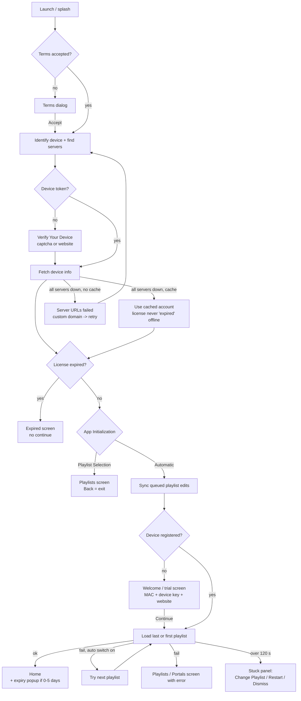
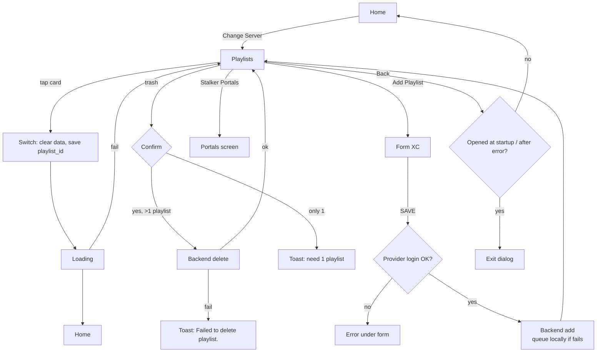
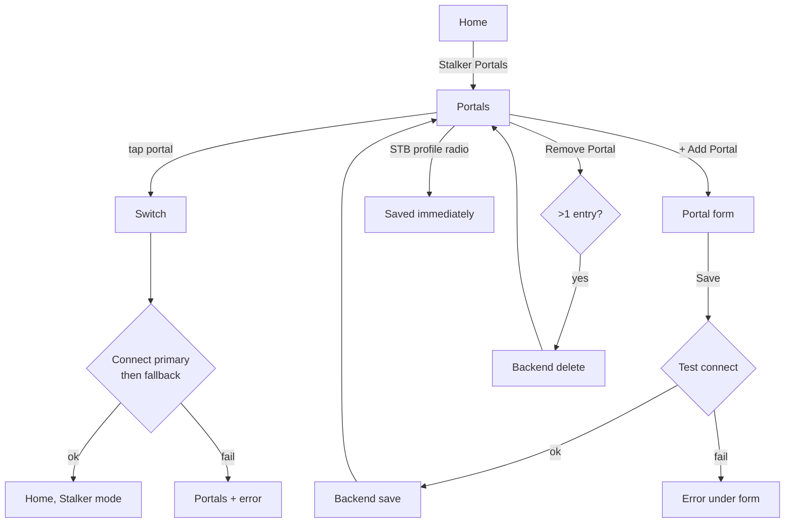
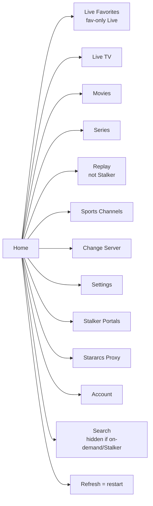
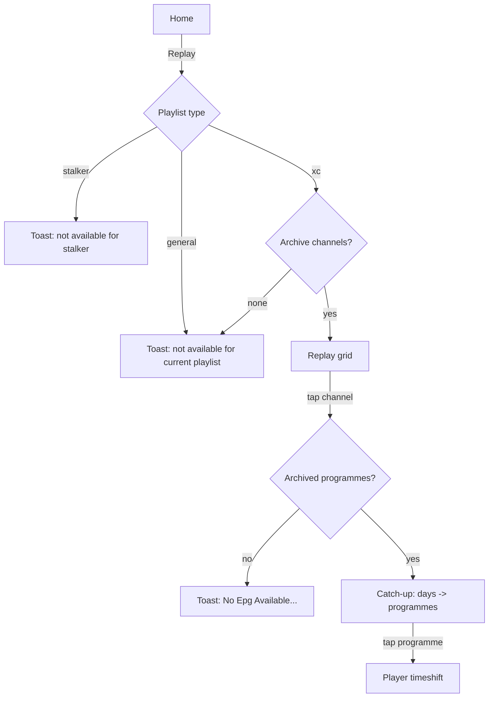
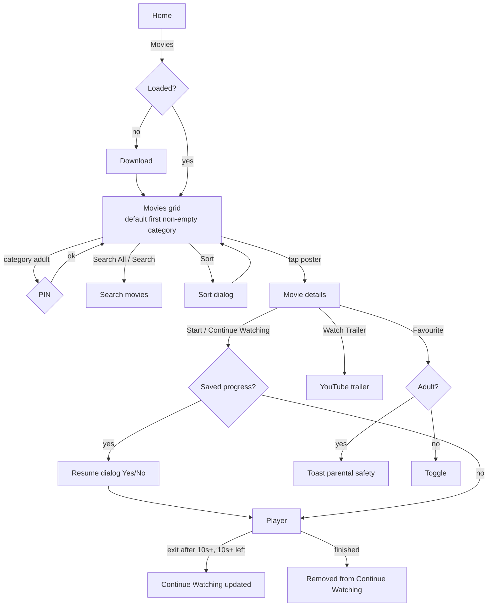
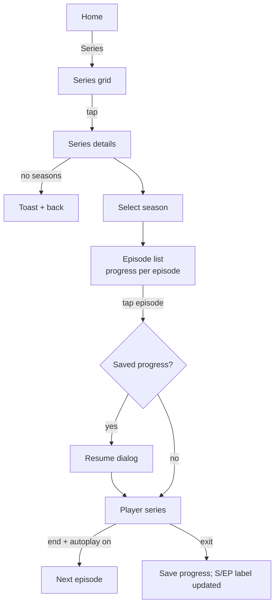
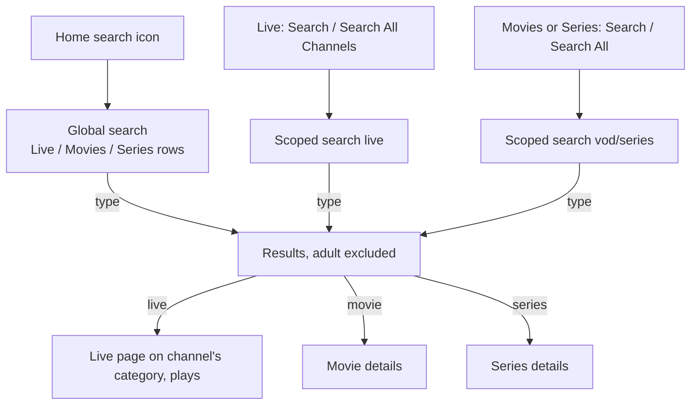
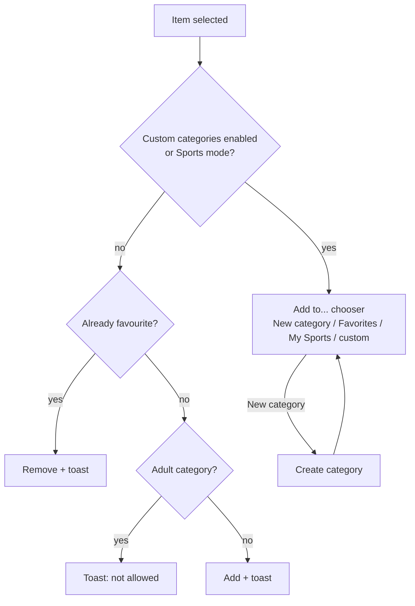
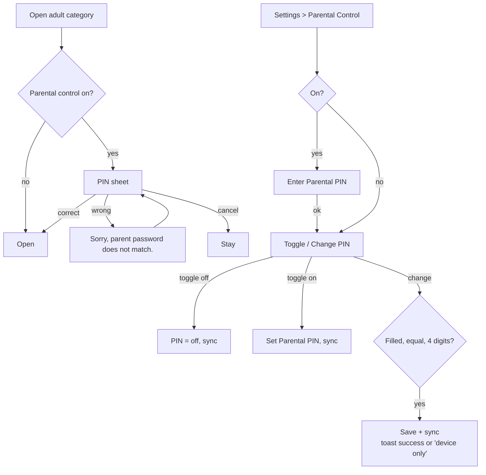

# User flows — IBOPlayer TV → IBOPlayer mobile

Step-by-step flows of the TV app, each followed by a **Mobile** subsection describing the React Native (Android phone, Netflix-style) equivalent with the same logic. Rules are referenced as R-xxx (`business-rules.md`); screens as in `current-app-inventory.md`; settings in `settings.md`.

## Mobile navigation model (used by every "Mobile" section)

- **Bottom tabs:** `Home` · `Live TV` · `Movies` · `Series` · `My List` (layouts: 03-design/screens.md).
  - `Home`: Netflix-style hero + rows (Continue Watching, Favourites, Recently Viewed channels, Top Rated, Newly Added, Sports entry, Replay entry). It replaces the TV tile home.
  - `My List`: Favourites, Continue Watching and Downloads (01-product/new-features.md N-02, N-03).
  - **Account** (the profile avatar at the top right of every tab): Account details, Playlists ("Change Server"), Stalker Portals, Settings, Stararcs Proxy, Custom Categories, Clear cache, Reload, About/website. Wherever this file says `Account → X`, it means this screen.
- **Header actions** on content tabs: Search (magnifier) and the profile avatar (→ Account); Cast is v2. The playlist name + expiry chip sit at the top of Home.
- **Android Back:** pops the stack; on a tab root goes to the Home tab; on Home exits (double-back toast "Press back again to exit", or the exit dialog for parity — R-130).
- **Gestures:** tap = open/select, long-press on a card/channel = action sheet (Add to Favourites / Add to… / Remove from Continue Watching / Info), swipe down on the player = minimise/close, horizontal swipe in fullscreen live = previous/next channel, pull-to-refresh on tab roots = reload that section (R-052 equivalent).
- **Loading:** full-screen splash only for boot/playlist switch; per-section skeletons + cancellable loader for on-demand downloads (R-050).
- TV-only elements dropped: colour keys, focus navigation, on-screen keyboards, idle auto-fullscreen, channel themes, number-key zapping.

---

## 1. First launch (terms → device → license → playlist)

1. App opens → splash.
2. If terms not accepted → Terms dialog → **Accept** (R-001).
3. Identify device (MAC-like id) → find backend servers (failover, R-004).
4. No stored device token → **Verify Your Device** (captcha or website verification) (R-003).
5. Fetch device info (device key, license expiry, trial days, playlists, parental PIN, languages, themes).
   - backend unreachable & cache exists → start offline from cache (R-004, R-005);
   - unreachable & no cache → "Server URLs failed" → custom domain → retry.
6. License expired → **Expired screen** (blocked) (R-006).
7. Keep Connection on → wait for proxy status (≤15 s) (R-110).
8. App Initialization = Playlist Selection → **Playlists screen** (Back = exit) (R-020). Otherwise:
9. Replay offline-queued playlist changes to the server (R-030).
10. Device not registered (trial) → **Welcome screen** with trial days, website, MAC + device key → **Continue**. Registered → skip.
11. Select last/first playlist → load it (Xtream / M3U / Stalker) with status texts; 120 s watchdog (R-011).
12. Success → Home (with playlist-expiry popup if ≤5 days, R-114). Failure → Playlists (or Portals) screen with error, or auto-switch (R-021).



### Mobile
- Onboarding stack (no tabs): Splash → Terms (full screen, sticky Accept) → Verify (captcha image + text field + Verify + New Code; secondary button "Verify on website" opening the verify URL, then "I've verified — Continue") → Welcome/Trial or Expired.
- Welcome/Trial and the empty-playlist state show a **"Add your playlist"** card: website `iboplayer.com`, MAC and Device Key with **Copy** buttons, "Open website" button (deep link to the qr-playlist page for this device), and "Continue" (demo). This replaces the TV "scan QR" pattern.
- Expired screen: same texts, "Open website to activate" button, "Check again" (re-fetch device info) — no Continue.
- Server URLs failed → full-screen error with text field + "Try again" + "Contact support (website)".
- Stuck panel → bottom sheet after 120 s with the same three actions.
- Show the boot status line under the spinner.

---

## 2. Choosing / switching playlist (Xtream / M3U)

1. Home → **Change Server** (or Live "Switch Page → Change Playlist").
2. Playlists screen: cards (name, CURRENT, expiry), toggles Auto Switch Playlist / Start on Playlist, Add Playlist, Reload, Playlists QR Code, Stalker Portals, Stararcs Proxy.
3. Tap a card → switch (R-040): clear loaded content, loading screen, login, Home.
4. Delete: trash → ✓/✕ → backend delete (R-033/R-034).
5. Add Playlist → form (Name, Host URL, Username, Password) → SAVE → provider test → backend save (queue on failure, R-030/R-031) → back to list. Or scan QR → add on website → Reload.



### Mobile
- `Account → Playlists` (also a playlist switcher chip on Home header opening a bottom sheet with the list).
- List items: name, CURRENT badge, expiry text, overflow menu (Delete; Edit hidden since editing is off). Swipe-left to delete with confirm dialog.
- FAB "Add playlist" → form screen with native keyboard, URL keyboard type for host, password field with show/hide, "Or add on the website" link (opens qr-playlist page). Validation messages as TV.
- Toggles Auto Switch Playlist / Start on Playlist at the top of the list; "Reload" = pull-to-refresh on the list (restarts content load).
- Switching shows the full-screen loader, then resets navigation to Home.
- Empty list: illustration + "Add your playlist" card (MAC, device key, copy, website).

---

## 3. Stalker portals

1. Home → **Stalker Portals** (or from Playlists).
2. Portals screen: list (name, ▶ Selected, URL, MAC), Device Information (model, Stalker virtual MAC, software MAC, device key), STB Profile radio (saved immediately), + Add Portal, Remove Portal, Portal URL QR, Playlists Page.
3. Tap portal → switch (R-040) → connect with profile, fallback URL (R-026) → Home. Failure → back here with error.
4. Add Portal → Name, Primary URL, Fallback URL (optional), MAC (prefilled), prefix 00:1A:79 / 00:1C:1D → Save → test connect (primary then fallback) → backend save (R-039/R-030).
5. Stalker content differences: no Replay, no Live Favorites tile, no global search, no live search, paged lists, no expiry popup (R-071, R-097, R-051).



### Mobile
- `Account → Stalker Portals`: same list; "Device information" card with copy buttons; STB profile as a segmented/radio list; FAB "Add portal"; swipe/overflow Delete with confirm (TV has none — add it).
- "Portal URL QR" → "Add on website" button.

---

## 4. Home

- Tiles: Live Favorites (conditional), Live TV, Movies, Series, Replay; controls: Sports Channels, Change Server, Settings, Stalker Portals, Stararcs Proxy; icons: Account, Search (conditional), Refresh.
- On-demand sections load on first open (cancellable) (R-050).
- Expiry block + popup (R-114); weather/date/clock; proxy country.
- Back → exit dialog.



### Mobile
- Home tab: header (logo, playlist name chip, expiry chip "Expires in N days" hidden for Stalker/unlimited, proxy "Connected to X" chip, search icon, account avatar → Account).
- Hero: a featured movie/series (e.g. first of Continue Watching or a random Top Rated) with Play / Info.
- Rows (horizontal): Continue Watching (movies), Continue Watching (series, "Recently Viewed"), Live Favorites (if allowed, R-071, setting 2.12), Recently Viewed channels, Top Rated movies, Newly Added, Top Rated series, Recently Added/Updated, Sports (card opening Sports mode). Rows appear only when their data is loaded — with Load on Demand, show "Tap to load Movies" placeholders or load movies/series lazily on Home focus (product choice; recommended: load the data needed for Home rows in the background after Home appears, keeping R-050's spirit of a fast start).
- Replay entry: row card or item in the Live tab header ("Replay"); for Stalker/M3U show the TV toasts.
- Expiry popup: modal bottom sheet with the same texts and Dismiss (once per app start).
- Global search: available when data is loaded; for on-demand, search only loaded sections or trigger loading (show a hint).

---

## 5. Live TV (with EPG and catch-up)

1. Open Live (loads on demand). Title "Live Channels".
2. Initial selection per Live Initialization (R-092): Default / Last / Favorite; plays the first channel.
3. Categories: Search All Channels (→ search), Recently Viewed, Favourites, custom, provider categories (flags), counts. Adult → PIN (R-061).
4. Channels: tap = preview, tap again = fullscreen (R-091). Info panel with Now/Next EPG (R-095).
5. Actions: Move (reorder, R-093), Search, Fav / Add to… (R-062, R-080), Switch Page, Arrange (R-094), EPG Guide (R-096).
6. Fullscreen: overlay (logo, number, name, now/next + progress), previous/next channel, channel strip with Now/Next/Later, aspect ratio, subtitles, audio, favourite. Back → list.
7. EPG Guide: today's grid for the category; tap current/future programme = preview, again = fullscreen live; past → "Catch-up is not available from the guide".
8. Catch-up is reached via **Replay** (section 6), not from Live.

```mermaid
flowchart TD
  H[Home] -->|Live TV| LD{Live data loaded?}
  LD -- no --> DL[Download categories+streams\ncancellable] --> INIT
  LD -- yes --> INIT[Pick initial category/channel\nLive Initialization]
  INIT --> LP[Live page: categories | channels | preview]
  LP -->|tap adult category| PIN{PIN ok?} -- yes --> CH[Show channels]
  PIN -- cancel/wrong --> LP
  LP -->|tap channel| PV[Preview plays\nadded to Recently Viewed]
  PV -->|tap same channel| FS[Fullscreen]
  FS -->|prev/next| FS
  FS -->|Back| LP
  LP -->|Fav| FAV{Custom categories on\nor Sports?}
  FAV -- no --> TG[Toggle favourite + toast]
  FAV -- yes --> ADD[Add to... chooser]
  LP -->|Search / Search All| SRCH[Search page live]
  LP -->|EPG| EG{M3U or empty?} -- no --> GUIDE[EPG Guide] -->|tap programme twice| FS
  LP -->|Arrange| AR[Arrange Categories] -->|Save| LP
  LP -->|Switch Page| SWP[Movies / Series / Replay / Settings / Change Playlist]
  LP -->|Back| H
```

### Mobile
- **Live TV tab**, portrait: sticky mini player at the top (16:9) showing the preview; below it a horizontal chip bar of categories (Search All → opens search; Recently Viewed; Favourites; custom; provider categories with flag emoji/images and counts) — or a "Categories" button opening a searchable bottom sheet for long lists; below, the vertical channel list (number, logo, name, now-playing programme + progress bar, star).
- Tap a channel = play in the mini player (TV "first tap preview"); tap the playing channel or the player / rotate to landscape = fullscreen (TV "second tap"). No idle auto-fullscreen.
- Fullscreen landscape: overlay auto-hides after ~7.5 s; swipe left/right or buttons = previous/next channel; swipe up = channel strip with Now/Next/Later; buttons: EPG, Aspect ratio, Subtitles, Audio, Favourite; Back/swipe down = exit fullscreen.
- Long-press channel → action sheet: Add to Favourites / Remove, Add to… (custom categories, My Sports Channels), Move (enter reorder mode with drag handles), Show guide.
- Header buttons: Search, EPG Guide (hidden for M3U), Arrange (hidden in Sports/fav-only), overflow "Replay".
- EPG Guide screen: vertical channel list with a horizontally scrollable time grid (pinch/scroll), now-line, tap programme = select channel (preview), tap again = fullscreen live; past programme → toast. Same lazy loading rules (R-096).
- Arrange Categories: two sections (All categories with search + checkboxes / Picked order with drag handles), Reset, Save; unsaved-changes dialog on Back.
- PIN overlay → native numeric PIN sheet (4 boxes, numeric keyboard, Cancel).
- Stalker: infinite scroll on channel list pages; no search button.

---

## 6. Replay (catch-up)

1. Home → Replay. Stalker → toast "Replay not available for stalker portals". Non-Xtream (M3U) or no archive channels → "Replay not available for current playlist" (R-097).
2. Grid of live categories with archive channels (sidebar, sort, search; no favourites/theme).
3. Tap channel → fetch archive EPG → **Catch-up** screen: past days list → programmes (finished only) → tap → player (timeshift).
4. Errors: no EPG / no archive → toasts.


*(TV note: the Replay grid code also has a Stalker branch with portal EPG, reachable only from search; the Home tile blocks Stalker.)*

### Mobile
- Entry from Live tab header "Replay" (and optional Home row). Screen: category chips + channel list (only archive channels). Tap channel → Catch-up screen: horizontal day tabs (e.g. "Mon Sep 9"), list of programmes (time, title, description expandable) → tap → player.

---

## 7. Movies

1. Home → Movies (loads on demand).
2. Sidebar categories (Search All Movies, Continue Watching, Favourites, Top Rated, Newly Added, custom, provider); adult → PIN; category search box.
3. Top: Search, Sort (Default/Added/A-Z/Z-A/Rating), Theme (Classic/Modern).
4. Grid of posters (NEW badge, progress, star); hero info + trailer preview after idle (TMDB on).
5. Tap → Movie details → Start/Continue Watching → player (resume dialog R-075); Watch Trailer; favourite (R-062, applied on leaving R-078).



### Mobile
- **Movies tab**: Netflix rows instead of a sidebar: Continue Watching, Favourites, Top Rated (ranked 1–10 cards, shuffle icon when allowed R-055), Newly Added, custom categories, then one row per provider category (lazy rendering; "See all" → full grid for that category with sort menu). A "Categories" chip opens a searchable list of all categories (replaces the TV category search box). Adult categories show a lock icon; opening asks PIN every time.
- Sort: menu on the category grid (Default, Added, A-Z, Z-A, Rating) persisted in `vod_sort`.
- Details screen: backdrop header with TMDB logo or title, rating, year · duration · genre, big Play/Continue button with progress bar and %, Trailer button (if YouTube id), My List (star) button, synopsis, director, cast carousel (TMDB on). Favourite applies immediately on mobile (visual), same restrictions.
- Trailer preview on hover → autoplay muted trailer in the details header (optional) instead of the TV 5-s idle trigger.

---

## 8. Series (seasons / episodes)

1. Home → Series. Rows: Search All Series, Recently Viewed, Favourites, Top Rated, Recently Added/Updated, custom, provider.
2. Tap → Series details: seasons (sorted, empty removed) → episodes (duration, progress %) → tap → player (series mode: next/previous episode, autoplay setting).
3. Favourite toggle on details (applied on leaving). Errors: No seasons (goes back) / No episodes.



### Mobile
- Series tab mirrors Movies tab. Details: header + Play button that resumes the **last watched episode** ("Continue S2:E5", from R-076) or plays S1E1; season dropdown/segmented tabs; episode list with thumbnail, title, duration, progress bar; My List button; synopsis/cast/genre.

---

## 9. Details pages (summary)
See 7 and 8. Common rules: loader until provider info arrives (Back cancels); TMDB enrichment only if TMDB on (R-122); Stalker info from portal + TMDB title search; favourites respect adult rule (movies).

### Mobile
Single reusable Details screen component for movie/series with the sections above; opened as a stack screen (or modal card with drag-to-dismiss).

---

## 10. Search

1. Global search (Home icon; hidden if on-demand or Stalker): three rows Live TV / Movies / Series, as you type (400 ms debounce).
2. Scoped search (Live, Movies, Series, Replay): ≥3 chars, suggestions + results grid. Stalker: portal search for movies/series.
3. Tap result → Live on that channel / Movie details / Series details / Replay grid.
4. Adult categories and duplicate rows excluded (R-064).



### Mobile
- Search screen from the header icon of any tab, pre-scoped to that tab (segmented control: All / Live / Movies / Series). Native keyboard, debounce 400 ms, minimum 2 characters (unify; see notes), results as rows (All) or grid (scoped). Empty state "No results found!". For Stalker: Movies/Series via portal search; Live disabled with explanation.

---

## 11. Favourites

- Live: Fav action → toggle (or "Add to" chooser when custom categories on / Sports mode). Adult blocked. Toast "<name> added to Favorites." / "removed from Favorites.". Favourites row in Live; Home "Live Favorites" (not Stalker, setting).
- Movies/Series: Fav on the grid (Yellow) or star on details. Favourites row. Limits R-070.



### Mobile
- Star/"My List" button on details and long-press action sheet on cards/channels; toast/snackbar with Undo. Chooser = bottom sheet with checkboxes (same rows). Live Favorites = Home row + Live chip.

---

## 12. Continue watching / recent

- Movies/episodes: progress saved (R-073), resume dialog (R-075), rows Continue Watching (movies) / Recently Viewed (series) max 15 (R-074), card progress bars, series "S{n}EP{m}" label.
- Live: Recently Viewed (15) (R-072); Live Initialization "Last" uses it.
- Clear: Settings → Clear Watch Lists (per type).

### Mobile
- Home rows "Continue Watching" (movies + series merged or separate — keep separate to mirror TV) with progress bars; long-press → "Remove from Continue Watching" (new; optional, deletes that item's progress). Settings → Clear Watch Lists kept. Save progress also on app background (TV does on visibility change).

---

## 13. Parental PIN

- Locked: adult categories on Live/Movies/Series/Replay (every time), Settings → Parental Control panel (when on). Blocked (no PIN prompt): adding adult items to favourites; adult items never in history/progress/search/Top Rated/New rows (R-060…R-064).
- Manage: Settings → Parental Control: enter PIN → toggle on/off (on asks a new PIN) / change PIN (New + Confirm) → synced to server (R-065, R-066). Default 0000; server `parent_pin` wins at login.



### Mobile
Same logic with a native PIN sheet (numeric keyboard, 4 boxes, biometric unlock NOT added unless product decides). Lock icons on adult categories.

---

## 14. Settings
Home → Settings (opens Media Player). 16 items (settings.md). Back → Home.

### Mobile
`Account → Settings` grouped list: Playback (Media Player, Auto Switch Player, Subtitle Settings, Autoplay), Content (Hide Categories, Load on Demand, Live Initialization, Toggle TMDB, Toggle Home Favorites, Custom Categories), Startup (App Initialization, Auto Switch Playlist), Appearance (Language, Font Size, App Theme — optional), Safety (Parental Control), Storage (Clear Watch Lists, Clear Cache). Channel Theme and Movies Theme Control dropped. Each opens a detail screen/radio dialog; descriptions from the same keys.

---

## 15. Account
Home → Account icon: Device info (MAC, device key, platform), App info (status Active/Trial, license expiry, version), Playlist info (username/portal MAC, status, expiry). Read-only.

### Mobile
`Account` (the avatar on every tab). Same three cards, copy buttons on MAC/device key, "Open website to manage playlists" and "Activate license" links.

---

## 16. Clear cache / clear recent
- Clear Cache: wipe everything, restart (R-120). Clear Watch Lists: movies / series progress of current playlist (R-077).

### Mobile
Settings → Storage: both with confirmation dialogs; after Clear Cache reset navigation to Splash (device verification may be required again).

---

## 17. Expiry notifications
- Playlist (Xtream) expiring in 0–5 days → popup on Home entry (R-114); Home expiry block always visible ("Unknown" if not known; hidden for Stalker).
- App license: shown on Home/Account; expired → blocked at startup (R-006). Trial days on Welcome screen.

### Mobile
Home expiry chip + bottom-sheet notice once per launch; optional local notification is **not** in the TV app (don't add without a product decision).

---

## 18. Stararcs proxy (optional service)
Home/Playlists → Stararcs: check subscription → not active (QR subscribe + Continue re-check) / active (toggle connection, region, country, keep connection, quota, logout). Status toasts; device may need verification first.

### Mobile
`Account → Stararcs Proxy`: same states; "Subscribe" opens the subscription URL in the browser instead of a QR; Region/Country as pickers.

---

## 19. Exit
Back on Home (and on startup-only Playlists/Portals, Terms, Welcome, Captcha) → "DO YOU WISH TO EXIT APP?" Yes/No.

### Mobile
Back on Home tab: double-back to exit (or same dialog). Leaving the app while playing: save progress (R-073); background audio/PiP is a player decision (see player.md).

---

## Notes / uncertainties
- Search minimum length differs on TV (global ≥1, scoped ≥3, legacy live dialog ≥2) — recommend ≥2 everywhere on mobile.
- Home rows on mobile need movies/series data while TV Home needs none; with Load on Demand the product owner must decide between background prefetch after Home is shown (recommended) or placeholders.
- Replay for Stalker: the Home tile blocks it, but the replay grid has Stalker support; product decision whether mobile enables it.
- "Continue" on the trial Welcome screen loads the device's playlists (or the demo entry); if the only entry is the URL-less demo, the user lands on the Playlists screen with "This playlist has no server address…".
