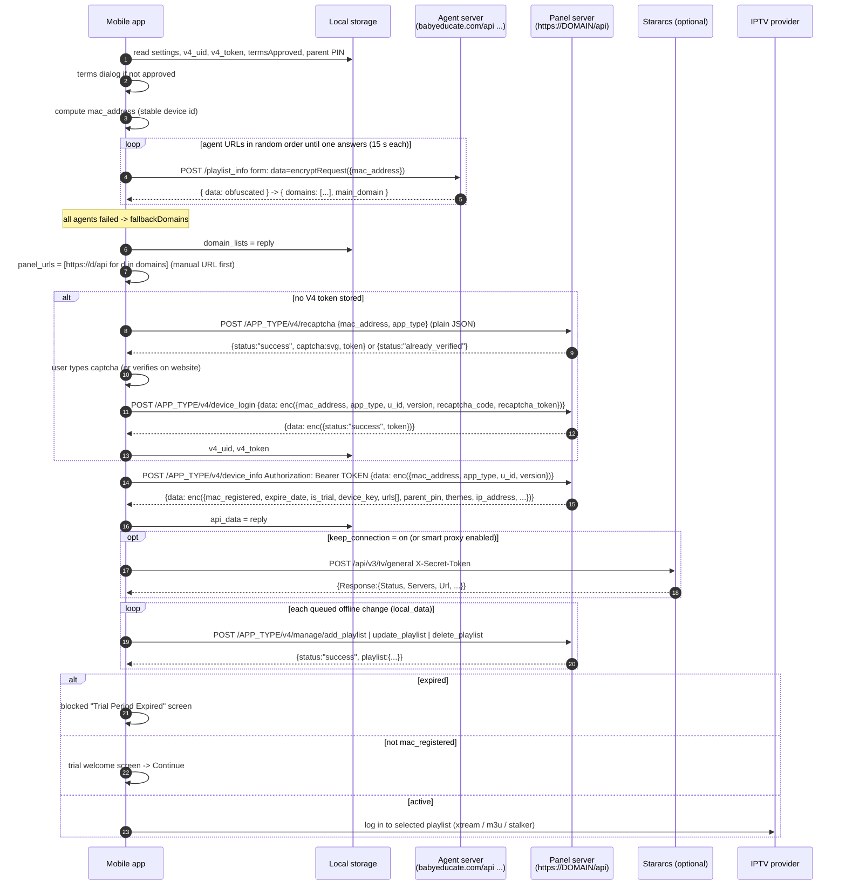

# IBO backend: overview

What the IBOPlayer TV app talks to (apart from the IPTV providers and the player), how it picks a working server, and the order of calls from app start to the first playlist load.

Files in this folder:
- [overview.md](overview.md) — this file: servers, server selection, startup sequence.
- [device-and-auth.md](device-and-auth.md) — device identity, the V4 registration flow, the request/response obfuscation, account states.
- [ibo-api-reference.md](ibo-api-reference.md) — every IBO endpoint, one section each.
- [services.md](services.md) — TMDB, image cache, analytics, Stararcs, weather, subtitles, store backend, language packs, QR codes.
- [config.json](config.json) / [config.md](config.md) — every constant.

---

## 1. The servers

| Role | Hosts | Used for | Port to mobile? |
|---|---|---|---|
| **Agent servers** | `https://babyeducate.com/api`, `https://babyeducationonline.com/api` | Return the current list of panel domains (`POST /playlist_info`). | Yes |
| **Fallback panel domains** | `app.ibo-dev.com`, `iboapp.mimocodes.com`, `iboapi.mimocodes.com` (`main_domain` `api.ibo-dev.com`) | Used as the panel list when every agent server fails. | Yes |
| **Panel servers** (the IBO backend proper) | Whatever the agent returns, as `https://<domain>/api` | V4 device API (`/<app_type>/v4/...`), parental PIN, playlist expiry report, background images (`/images/upload/<file>`). | Yes |
| Static panel list in app.json | `iboiptv.com`, `iboplayer.com`, `ibotvplayer.com`, `tvplayeribo.com`, `ibobtv.com` (each `/api`) | Initial value only; replaced before first use (see Notes). | Optional last resort |
| **Customer website** | `https://iboplayer.com` | User manages playlists (MAC + device key), web device verification (`/device/verify`), QR playlist upload (`/qr-playlist`). Never called by the app, only linked. | Yes (links / QR) |
| Analytics | `https://iboanalytics-backend.biduplive.com/api/events` | Usage events. | Yes |
| Stararcs | `https://backend.stararcs.com` + CDN mirror list | Smart-proxy subscription and servers. | Optional feature |
| IBO image cache | `https://tmdb.iboplayer.com/api` | TMDB artwork mirror (XC playlists only). | Yes |
| IBO subtitles | `https://ibosub.com/api` | Subtitle search/download. | Player feature |
| TMDB | `https://api.themoviedb.org/3`, `https://image.tmdb.org/t/p/` | Artwork, credits, search. | Yes |
| weatherapi.com | `https://api.weatherapi.com/v1/forecast.json` | Home-screen weather, analytics location. | Optional |
| Store backend (ibosol) | `https://backend.ibosol.com` | TV boot loader only: decides whether to load app code remotely. | **No** |
| TV asset hosts | 10 `hostUrls`, jsDelivr CDN | TV boot loader downloads the web app code. | **No** |

---

## 2. TV boot loader (TV-specific — do NOT port)

For completeness, since it explains some globals. The installed TV package contains a small frozen `host.js` that loads the real app (`init.js` + bundles):

1. If `boot.assets` is `"local"` (the IBOPlayer default), it loads the packaged files directly. Nothing below happens.
2. Store builds (`"remote"`) first call `GET https://backend.ibosol.com/api/application-settings/IBOPLAYER` with header `X-Version: 1.0`. If `response.data.is_remote` is true, assets are loaded remotely and `response.data.fallback_time` (seconds) replaces the 8 s fallback timer; otherwise local. Errors → local.
3. Remote: shuffle the 10 `hostUrls` (Fisher–Yates), `GET <host>api/status_check` each in turn; the first answering `{"status":"success"}` becomes `HOST`, and `HOST + "iboplayer/app_src_min/js/init.js"` is loaded.
4. All hosts fail: ask Stararcs for an HTTP proxy IP (`POST https://backend.stararcs.com/api/tv/server/asset`, header `X-Secret-Token: <tvAssetToken>`, 3 s timeout, mirror domains from the CDN list if the primary is unreachable). Reply `{Success, Response: {ServerAsset: "<ip>"}}`. Then retry `status_check` through `http://<ip>:7650/http-proxy?target_url=<url>` (5 s each). When this path wins, **every later backend call** (agent and V4) is prefixed with `http://<ip>:7650/http-proxy?target_url=` (`hostProxiedPrefix`).
5. Then try jsDelivr `https://cdn.jsdelivr.net/gh/MIMOCODES-DEV/CodersCode/iboplayer/app_src_min/js/init.js`.
6. Then fall back to local files. A global 8 s timer forces local files at any point.

A mobile app ships its own code, so none of this applies. The `hostProxiedPrefix` censorship workaround could be reconsidered later as a product feature; it is plain http and was flagged as a security risk.

---

## 3. Startup sequence (what the mobile app should reproduce)

In order, as the TV runs it:

1. **Local init.** Load settings from storage. Start an analytics session. Load the saved parental PIN (`parent_account_password`, default `0000`).
2. **Stararcs keys reset.** If the "keep connection" setting is not `on`, the smart-proxy selection keys are cleared on every cold start (not on an in-app "reload"). See services.md.
3. **Terms.** If `termsApproved` is not stored, show the local Terms dialog (static text, no backend). Accepting stores `termsApproved = "true"`.
4. **Stuck timer.** A 120 s timer starts; if the loading screen is still up when it fires, the user gets "Stuck on loading screen?" with Change Playlist / Restart App / Dismiss.
5. **Identify the device** (MAC, platform; see device-and-auth.md).
6. **Find the panel servers** (section 4): agent call → panel URL list.
7. **V4 device flow**: token present → `device_info`; otherwise `recaptcha` → captcha → `device_login` → `device_info`.
8. **On `device_info` success** (`onDeviceInfo`):
   1. If expired → expired screen, stop.
   2. Store the whole reply as `api_data` (offline cache). Take `ip_address` and `themes`.
   3. If no background is chosen yet, choose the first theme's file name; set the background to `<working panel host>/images/upload/<file>`.
   4. Start the weather lookup (non-blocking).
   5. Analytics: flush if ≥10 events are buffered, or if the oldest event is ≥24 h old.
   6. If "keep connection" is on: call Stararcs `general` first and wait for it (max 15 s), so the first IPTV request already goes through the proxy. Otherwise start immediately, and if the smart proxy is enabled call `general` in the background.
9. **Start the app** according to the "App initialization" setting:
   - `automatic` (default): **sync** queued offline playlist changes to the server (replay add/update then delete, one call each), merge results into the playlist list, then `loadApp`: store playlists/device key/expiry/PIN, apply the account state (trial screen / active → auto-login into the selected or first playlist).
   - `playlist_first`: store the same data and open the playlist chooser instead of auto-loading.
10. **Load the playlist** from the IPTV provider (covered by the Xtream/M3U/Stalker docs).

### Sequence diagram



---

## 4. Server selection in detail

### 4.1 Domain policy "server" (IBOPlayer)

1. Pick a random agent URL not yet tried (`agentUrls`, 2 entries).
2. `POST <agent>/playlist_info`, form-encoded body `data=<encryptRequest({mac_address})>`, 15 s timeout. (If the TV boot used the Stararcs asset proxy, the URL is prefixed with `hostProxiedPrefix`.)
3. On success: `decryptResponse(reply)` → `{ domains: [...], main_domain: "..." }`. Stored as `domain_lists`. Continue with it.
4. On any error: mark that agent tried; if untried agents remain, go to 1. When all have failed, use `fallbackDomains` (the stored `domain_lists` from a previous boot is read but then ignored — a TV bug; both branches use `fallbackDomains`). The mobile app should prefer the last good `domain_lists`, then `fallbackDomains`.
5. There is no retry of the whole cycle and no backoff.

Other policies exist in the shared codebase but are not used by IBOPlayer: `"static"` (always `fallbackDomains`, the agent is still called but its answer ignored) and `"remote_config"` (a CDN JSON `{domain_list: [...]}`).

### 4.2 Building the panel URL list

```
if a manual server URL is saved (key "_manually_chosen_url") and this is not already a manual retry:
    domains.unshift(savedManualUrl)
panel_urls = []
for d in domains:
    clean = d without leading "http://" or "https://" and without trailing "/api"
    panel_urls.push("https://" + clean + "/api")
```

Order is the agent's order (not shuffled).

### 4.3 Server failover (V4 calls) {#server-failover}

Every V4 call (`requestFailover`) walks this list, in order:

```
bases = []
if a manual URL is saved: bases.push( (has scheme ? url : "https://" + url) without trailing "/" or "/api", + "/api")
for u in panel_urls: if u not in bases: bases.push(u)
```

- Try `bases[0]`; on a **transport failure** move to the next, showing "Server busy, trying another (n/N)...".
- Transport failure = no HTTP response, timeout (15 s), or an HTTP error without a parseable JSON body, or a success body that fails to decode. An HTTP error **with** a JSON body is treated as the server's answer (no failover).
- The first base that answers is remembered as `workingWebsiteHost = base.replace("/api", "")` (used for background images). If it matches the manual URL, the manual URL is saved permanently.
- If every base fails, a saved manual URL is deleted, and the caller's error runs. For the boot flow that means the **"Server URLs failed"** screen.
- Each call starts again from `bases[0]`; the working server is not moved to the front.

### 4.4 "Server URLs failed" screen (manual server)

Shown when the boot V4 flow cannot reach any server (or `device_info` returns a non-404 error). Text: "Server URLs failed — You can contact our customer support to get a custom URL to retry. visit our website iboplayer.com". If the Stararcs mirrors also failed, the title becomes "Server & backup URLs failed" with "All backup connection servers were unreachable. Code: E-SX-ALL".

The user types a domain (placeholder `example.com`) and presses "Try again":
```
url = input.trim() without trailing "/api" and without trailing "/"
panel_urls = [ (url has http(s):// ? url : "https://" + url) + "/api" ]
restart the V4 flow
```
It is persisted under `_manually_chosen_url` only after a server answers through it.

### 4.5 Timeouts summary

| Call | Timeout |
|---|---|
| Agent `playlist_info` | 15 s |
| V4 calls | 15 s per server |
| `changeParentPin`, `edit_playlist` | none (browser default) |
| Stararcs calls | 8 s per domain (15 s for unlink), 15 s startup gate |
| Analytics | 15 s |
| Whole boot | 120 s "stuck" prompt (does not cancel anything) |

---

## 5. Local persistence (backend-related keys)

TV localStorage keys are `"gz3rYzUIC7_" + suffix`. All values are strings. The mobile app does not need the same key names (there is no data to migrate from a TV), but it needs the same **data**.

| Key (full) | Holds | Written when | Mobile equivalent |
|---|---|---|---|
| `gz3rYzUIC7_v4_uid` | 6-char device `u_id` | after the backend accepts it | secure storage |
| `gz3rYzUIC7_v4_token` | V4 Bearer session token | `device_login` success; deleted on 404 / auth failure | secure storage |
| `gz3rYzUIC7_api_data` | JSON of the last successful `device_info` reply (after boot-time sync merges). Offline cache: used when no server answers. Also the fallback source of `device_key`. | every successful `device_info` / sync | storage |
| `gz3rYzUIC7_domain_lists` | JSON `{domains, main_domain}` from the agent | agent success | storage (and actually use it as a fallback) |
| `gz3rYzUIC7__manually_chosen_url` | Manual server typed on "Server URLs failed" (note the **double underscore**: the suffix is `_manually_chosen_url`) | once a server answers through it; deleted if all servers fail while using it | storage |
| `gz3rYzUIC7_local_data` | JSON `{ playlist_urls: [queued playlist entries], remove_ids: [ids] }`: playlist saves that failed and must be replayed at next boot | failed add/update; cleaned after replay | storage |
| `local_data` (no prefix) | Written by the TV's offline sync path by mistake | — | ignore (bug) |
| `gz3rYzUIC7_parent_account_password` | Parental PIN, or `"off"` | from `device_info.parent_pin`; on local change | secure storage |
| `gz3rYzUIC7_playlist_id` | id of the selected playlist | selection / auto-select | storage |
| `gz3rYzUIC7_playlist` | JSON of the selected playlist entry | selection | storage |
| `gz3rYzUIC7_bg_img_file`, `gz3rYzUIC7_bg_img_name` | Chosen background file name / theme name | theme picker; default = first server theme | storage |
| `gz3rYzUIC7_termsApproved` | `"true"` once terms accepted | terms dialog | storage |
| `gz3rYzUIC7_app_initialization_choice` | `automatic` / `playlist_first` | settings | storage |
| `gz3rYzUIC7_auto_switch_playlist` | `on` / `off`: on a playlist load failure, try the next playlist | playlists page | storage |
| `gz3rYzUIC7_language` | UI language code | settings | storage |
| `gz3rYzUIC7_all_playlists_info` | JSON map `hash -> {playlist_type, fetched_at, expiry_date, status, auth}`: provider account info per playlist (hash of host+user+pass, 32-bit string hash in base 36) | playlists page provider check, or from `device_info.urls[]` fields | storage |
| `gz3rYzUIC7_weather-forecast` | JSON weather cache | weather lookup | storage |
| `gz3rYzUIC7_analytics_active`, `gz3rYzUIC7_analytics_sessions` | Active analytics session; buffered events | analytics | storage |
| `gz3rYzUIC7_stararcs_secret_token` | Stararcs `X-Secret-Token` | IBO `device/add`; deleted on unlink | secure storage |
| `gz3rYzUIC7_stararcs_base_url` | Last Stararcs domain that answered | Stararcs success | storage |
| `gz3rYzUIC7_stararcs_domain_list` | Last Stararcs mirror list from the CDN | CDN success | storage |
| `gz3rYzUIC7_smart_proxy_connection_state` / `_region` / `_country` / `_server`, `gz3rYzUIC7_keep_connection` | Smart-proxy settings | Stararcs page | storage |
| `gz3rYzUIC7_isRefresh` | `"true"` set just before an in-app reload, to keep proxy settings across it | "Reload the app" | not needed |

Not persisted on TV: `mac_address` (re-derived each boot; the mobile app **should** persist its derived id), `app_type`, `expire_date`, `is_trial` (only inside `api_data`).

Other keys in the same storage belong to other areas (favourites, resume positions, EPG, `load_on_demand`, `saved-movie-info`, the unprefixed Stalker `stalker_mac`). Per-playlist keys contain the playlist id and are renamed when the server assigns a real id to a `non_saved_...` playlist.

---

## Notes / uncertainties

1. **Static `panelUrls` are effectively dead** under `domainPolicy "server"`: `panel_urls` is overwritten by the agent/fallback list before any panel call. The mobile app may append them as a last resort after the fallback domains, but that is a behaviour change to confirm with the backend owner (they may point at a different backend generation).
2. The cached `domain_lists` is never used on TV (bug). Recommended for mobile: last good list, then fallback.
3. `main_domain` is received and stored but not used by any request.
4. The agent response shape `{domains, main_domain}` is inferred from how it is consumed; the agent may return more fields.
5. `hostProxiedPrefix` (Stararcs asset proxy) is TV-only and plain http; do not port without a product decision.
6. `app_type` is part of every V4 path; an unknown platform on TV produces `/api/undefined/v4/...`. Android needs an agreed value.
