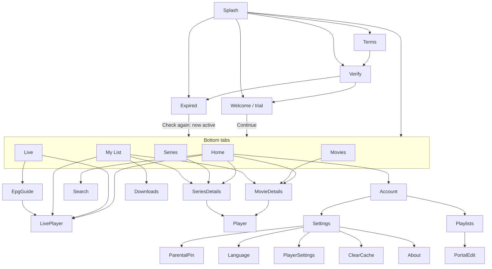

# Screens

Portrait phone layouts (360×800dp reference), built only from the components in
design-system.md. The **behaviour** of each screen (what data, which rules, which states) is
defined in 01-product/user-flows.md and business-rules.md. This file defines **layout and
navigation**. Strings are locale keys where the TV app already has one; `mobile_*` keys are new
(05-reference/translations.md).

## Navigation map



The profile avatar on the top bar opens **Account** (the device id, account status and expiry,
Playlists, Settings, About). This is where everything the TV app puts in its top controls row
lives (Playlists, Settings, Portals, Stararcs proxy, Account). Search is an icon on every tab's top
bar.

The Android back button and the predictive back gesture always go to the previous screen. On a
tab root, back goes to Home. On Home, a first back shows the toast "Press back again to exit", and
a second back within 2s exits. This replaces the TV "turn off" page (R-130).

---

## Splash

Black background, the centred logo (`splash-logo-dark-bg-1024.png`, 200dp wide), and a small
status line under it (`meta`, `text.secondary`) naming the boot step. Examples of the boot-step
messages: 02-backend/overview.md. After 10s on one step, show a Retry button.

## Terms (first launch only)

A full-screen scroll of the terms text, with a sticky bottom bar holding **Accept**
(`PrimaryButton`, brand) and **Exit**. The text and keys follow the TV terms dialog.

## Verify (first launch, when the backend asks for it)

The TV app verifies a new device with a captcha before it can register. The screen shows:
- The captcha image, a text field, **Verify**, and **New code**.
- A secondary **Verify on website** button, which opens the website's verify page for this
  device. After it, the user taps **I've verified — Continue**.

The exact endpoints, texts and states are in 01-product/user-flows.md (first launch) and
02-backend/ibo-api-reference.md.

## Welcome / trial, and expired

These screens follow the account states in 02-backend/device-and-auth.md:
- **Unregistered or trial:** a **Welcome** screen shows the trial days left, and the "Add your
  playlist" card below (website, device id and device key with copy buttons, and **Open website**).
  A **Continue** button enters the app with whatever playlists the backend returned (usually a
  demo playlist).
- **Expired:** the same card, with the expired wording. It has **Open website to activate** and
  **Check again** (fetches the device info again), and **no Continue**. The app is blocked until
  the account is paid.

Layout (the expired variant):

```
┌──────────────────────────────┐
│          [logo 120dp]        │
│  Your device is not active   │  h2 (TV key for the status text)
│  Visit iboplayer.com and     │  body, secondary
│  enter your device details   │
│ ┌──────────────────────────┐ │
│ │ Device ID   AB:CD:EF:…  ⧉│ │  surface.1 card; ⧉ copies
│ │ Device Key  123456      ⧉│ │
│ └──────────────────────────┘ │
│        ┌──────────┐          │
│        │  [QR]    │          │  QR 180dp, white quiet zone
│        └──────────┘          │
│  [ Open website to activate ]│  SecondaryButton → browser
│  [ Check again ]             │  PrimaryButton brand → re-fetch device info
└──────────────────────────────┘
```

The trial variant replaces the last two buttons with **Open website** and **Continue**. The QR
is optional on a phone: the user is usually on the same device, so **Open website** (a deep link
to this device's playlist page) matters more. Keep the QR for adding a playlist from another
device.

## Home (tab)

```
┌──────────────────────────────┐
│ [logo]          🔍  (avatar) │  TopBar, transparent over hero
│                              │
│      HERO ARTWORK 2:3        │
│      (scrims)                │
│   Drama • Thriller • 2024    │
│  ＋My List  [▶ Play]  ⓘ Info │
│──────────────────────────────│
│ Continue Watching            │
│ [16:9▬▬][16:9▬ ][16:9▬▬▬]    │
│ Live Now                 ›   │
│ [ch card][ch card][ch card]  │
│ Recently Added Movies    ›   │
│ [2:3][2:3][2:3][2:3]         │
│ …                            │
└──────────────────────────────┘
```

Below the top bar, `CategoryChips` offer **Movies**, **Series** and **Live** shortcuts (they
switch tabs) as on streaming apps. Row rules: 01-product/new-features.md N-01. Pull to refresh:
N-09. The expiry warning card (TV parity: the "playlist expires in N days" card) appears as a
dismissible banner at the top of the rows.

## Movies (tab) and Series (tab)

The same layout for both:

```
┌──────────────────────────────┐
│ Movies             🔍 (avatar)│
│ ( All categories ▾ ) (Sort ▾) │  chips; categories open a BottomSheet list
│──────────────────────────────│
│ [2:3][2:3][2:3]              │  3-column grid (4 on ≥ 480dp, 6 on tablets)
│ [2:3][2:3][2:3]              │  FlashList, paged from SQLite
│ …                            │
└──────────────────────────────┘
```

- The category sheet lists the TV app's categories in the same order, with the special categories
  first (All, Favourites, Recently watched …, as the TV app defines them; see business-rules.md).
  Locked categories show a lock and ask for the PIN.
- The sort sheet has the TV app's sort options.
- When no category is chosen, the tab shows **rows** (one per category, 10 items each, plus
  "See all ›") instead of the grid.

## Movie details

```
┌──────────────────────────────┐
│ ←                        ⋮   │
│   BACKDROP 16:9 (TMDB/cover) │
│ Title                        │  h2
│ 2023 · 2h 14m · ★ 7.8 [IMDb] │  meta
│ [▶ Play / Resume 38:12   ]   │  PrimaryButton (white), full width
│ [↓ Download]                 │  SecondaryButton, full width (hidden if not downloadable)
│ Synopsis …… more             │  body, 3 lines + expand
│ Cast: …   Director: …        │  meta
│ ＋My List   ▶ Trailer   ⤴Share │  icon buttons
│ More like this               │  row: same category
└──────────────────────────────┘
```

"Resume" appears only when a saved position exists. "Trailer" appears when the item has a YouTube
trailer (TV parity, player.md).

## Series details

As movie details, plus:

```
│ [ Season 1 ▾ ]               │  BottomSheet picker
│ ┌─────────┐ 1. Pilot    52m ↓│  EpisodeRow
│ │ still▬▬ │ Synopsis two lines│
│ └─────────┘                  │
│ …                            │
```

Play/Resume plays the next unwatched episode, or resumes the last one in progress.

## Live (tab)

```
┌──────────────────────────────┐
│ Live TV        [Guide] 🔍 (a)│  Guide → EPG guide
│ ( Favourites )( Sports )( All ▾ )│  chips: special + category sheet
│──────────────────────────────│
│ [logo] 101 BBC One        ♥  │  ChannelRow
│        News at Six ▬▬▬──     │
│        18:00 – 18:30         │
│ …                            │
└──────────────────────────────┘
```

This keeps the TV behaviour of "first select previews, second goes full screen" (user-flows.md,
Live TV):
- Tapping a channel plays it in a **sticky 16:9 mini player** at the top of the tab. The list
  scrolls under it.
- Tapping the mini player, or the same channel again, opens the **live player** (landscape, full
  screen).
- Leaving the tab stops the preview.

## Live player

Landscape and full screen. Its controls:
- **Top:** back, channel number and name, and the current programme and time.
- **Middle:** play/pause, only for streams that support pausing (catch-up).
- **Bottom:** a "Channels" button that opens a side panel listing channels of the current category,
  the programme progress, EPG ‹ › for the previous and next programmes, a catch-up button when the
  programme is in the archive, and audio/subtitle/aspect buttons.
- **Gestures:** swipe up or down on the right edge (outside the volume gesture area) zaps channels
  (N-04).

## EPG guide

`EpgTimeline` full screen, in portrait or landscape. A day picker sits at the top, and "Now" jumps
back to the current time. Tapping a current programme plays the channel. Tapping a past one with
an archive plays the catch-up. Tapping a future one shows its details (a reminder is v2).

## VOD player

See 01-product/player.md §3.
- **Top:** back, title (S1:E3 for episodes), and the audio/subtitles, speed, PiP and lock buttons.
- **Centre:** −10, play/pause and +10.
- **Bottom:** the seek bar with elapsed and remaining time, plus "Next episode" and "Episodes"
  buttons for series.

## Search

A full-screen text field that is focused on open, with segmented results: **All · Live · Movies ·
Series**. It shows recent searches when empty. Results appear as rows (All) or a grid (per type)
and come from SQLite FTS. Items from adult categories never appear in results, even with parental control off (R-064).

## My List (tab)

Segments: **Favourites · Continue Watching · Downloads**.
- Downloads groups episodes by series. Each item shows its size and a delete button (swipe to
  delete). A storage bar at the top shows "Used by IBO Player: 4.2 GB · Free: 18 GB".

## Account

The avatar, the device id and key (copyable), the account status and expiry date, and the current
playlist, followed by rows for **Playlists**, **Portals**, **Stararcs proxy**, **Settings**,
**Language**, and **About** (version, website). The TV account page fields: current-app-inventory.md.

## Playlists

A list of the device's playlists and portals from the backend. The active one is ticked; tap
another to switch (with a confirmation). The editing rules follow the iboplayer TV flags:
**playlist editing and M3U input are off** for IBOPlayer, so playlists are added on the website.
The empty state explains that and shows the device id and QR, like Activation. Portals can be
added and edited in the app if the TV app allows it (current-app-inventory.md).

## Settings

Grouped `SettingsRow`s. Every TV setting is included except TV-only ones (settings.md marks
which), plus the new phone settings:
- Downloads: Wi-Fi only, and the quality/storage info.
- Player: autoplay next episode, background audio, and default gestures.
- Notifications.
